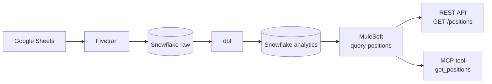

# energy-data-poc

A small end-to-end data integration POC using Fivetran, Snowflake, dbt and MuleSoft.

It takes artificial power trades and settlement prices, cleans them, calculates each desk's net position, and serves the result as a JSON API and a MCP Tool.



## What each part does

**Fivetran** syncs two Google Sheets tabs (`raw_trades`, `raw_prices`) into `FIVETRAN_DATABASE.GOOGLE_SHEETS`.

**dbt** (`energy_dbt/`) reads the raw tables and writes to `ANALYTICS.TRADING`:
- `stg_trades`: casts types, turns BUY/SELL into signed volume, removes a trade that was loaded twice
- `stg_prices`: casts types
- `net_position`: net MWh per desk and instrument, valued at the latest settlement price

Tests check that trade IDs are unique, side is BUY or SELL, volumes are positive, every traded instrument has a price, and the raw data is fresh.

**MuleSoft** (`energy-positions-api/`) exposes the `net_position` table as `GET /positions`.

## Output

```
curl http://localhost:8081/positions
```

```json
[
  { "desk": "power_de", "instrument": "DE_BASE_DEC", "netPositionMwh": -40, "settlePriceEur": 86,    "positionValueEur": -3440 },
  { "desk": "power_de", "instrument": "DE_PEAK_DEC", "netPositionMwh": 30,  "settlePriceEur": 111.2, "positionValueEur": 3336 },
  { "desk": "power_uk", "instrument": "UK_BASE_DEC", "netPositionMwh": 30,  "settlePriceEur": 94.1,  "positionValueEur": 2823 },
  { "desk": "power_uk", "instrument": "UK_PEAK_DEC", "netPositionMwh": 25,  "settlePriceEur": 119,   "positionValueEur": 2975 }
]
```

## Access

Each integration layer has its own Snowflake service user and role, using key-pair auth:

| User | Can do |
|---|---|
| `FIVETRAN_USER` | Write raw data to `FIVETRAN_DATABASE` |
| `DBT_USER` | Read raw data, write to `ANALYTICS` |
| `MULE_USER` | Read `ANALYTICS.TRADING` only |

Private keys and connection files are kept outside the repo.

## Running it

See the README in each folder:
- `energy_dbt/README.md`
- `energy-positions-api/README.md`


## MCP Server
- Runs at with `http://localhost:8081/mcp` 
- One tool: get_positions. Returns positions through the same subflow as `GET /positions`, so the agent recieves the same JSON response above.
- To test: run the MCP Inspector (`npx @modelcontextprotocol/inspector`), connect with Streamable HTTP to the URL above, and call `get_positions`.

## What I'd change for production

- Naming conventions: the databases by layer (`RAW`, `ANALYTICS`) and give dbt its own warehouse for cost tracking
- Key management: keep keys in a secrets manager and rotate them
- Write the API spec first so it could be shared with other teams (front end/AI)
- Add error handling, filtering and API Manager policies
- Run dbt on a schedule after each Fivetran sync, with alerts on failed tests
- Custom Fivetran connector as I doubt the data would be coming from Google sheets :D 
